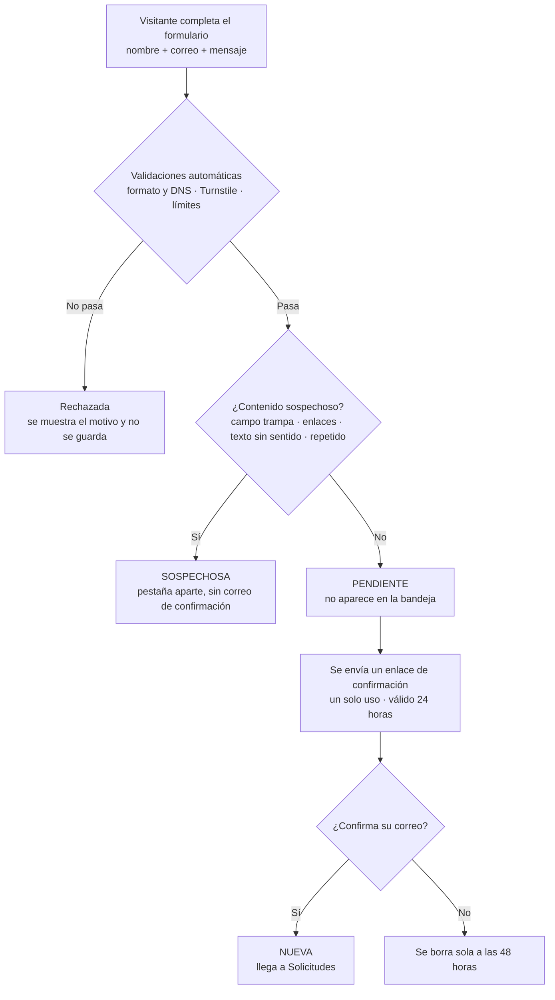

# Protección del formulario de contacto

El formulario público de **Contacto** es la única parte de AviSmart que cualquier persona puede usar sin cuenta. Para impedir que alguien llene la bandeja de **Solicitudes** con cientos de envíos falsos, se aplican seis capas de seguridad. Además, **ninguna solicitud llega a la bandeja hasta que la persona confirma su correo**.

---

## 1. Flujo de una solicitud



La respuesta del formulario es la misma para una solicitud normal y para una sospechosa, así un bot no sabe que fue detectado.

### Estados

| Estado | Significado | ¿Se ve en la bandeja? |
|---|---|---|
| **Pendiente** | Aún no confirmó su correo | No |
| **Nueva** | Correo confirmado, falta atenderla | Sí, pestaña *Nuevas* |
| **Contactada / Cliente / Descartada** | Ya atendida por la plataforma | Sí |
| **Sospechosa** | Detectada por el filtro antispam | Sí, pestaña separada *Sospechosas* |
| **Rechazada** | No pasó las validaciones | No se guarda |

En *Sospechosas* se ve el motivo de la detección y un botón **"Es legítima"** para pasarla a la bandeja si el filtro se equivocó.

---

## 2. Las seis capas

| # | Capa | Qué hace | Resultado si falla |
|---|---|---|---|
| 1 | **Formato y DNS** | Revisa que el correo tenga un formato válido, que no sea de un servicio desechable (mailinator, yopmail, 10minutemail…) y que el dominio reciba correo (registro MX en DNS). | Rechazada con mensaje. Ej.: `usuario@gmial.con` → "El dominio del correo no existe o no recibe mensajes". |
| 2 | **Cloudflare Turnstile** | Verificación antibots sin acertijos visuales. El token **se valida en el servidor**, no solo en el navegador. | Rechazada: "No pudimos verificar que eres una persona". |
| 3 | **Límites de envío** | 3 solicitudes cada 15 min por IP · 5 por correo al día · 60 por hora en total. | Rechazada (HTTP 429) con mensaje. |
| 4 | **Campo trampa (honeypot)** | Campo invisible para las personas; los bots suelen llenarlo. | Sospechosa. |
| 5 | **Contenido sospechoso** | Mensajes con 2 o más enlaces, texto sin sentido o el mismo mensaje enviado varias veces en 24 h. | Sospechosa. |
| 6 | **Confirmación por correo** | Enlace con un token aleatorio de un solo uso que vence en 24 h. Se guarda solo su *hash*. | Queda pendiente y se borra a las 48 h. |

**Protección para terceros:** como máximo se envían **3 correos de confirmación al día a una misma dirección**. Así nadie puede usar el formulario para llenar de correos la bandeja de otra persona.

**Confirmación con un clic:** el enlace abre una página de AviSmart que confirma con una petición al servidor, no con la sola apertura del enlace. Así los antivirus y escáneres de correo, que abren los enlaces automáticamente, no gastan el token.

Los límites son valores iniciales; se ajustan en `backend/app/antispam.py` según el tráfico real.

---

## 3. Configuración (`backend/.env`)

| Variable | Para qué sirve |
|---|---|
| `AVISMART_DEV` | `true`: si no hay correo configurado, el enlace de confirmación se muestra en pantalla para poder probar. **En producción, `false`.** |
| `AVISMART_URL_PUBLICA` | Dirección de la web que va dentro del enlace del correo (hoy `http://127.0.0.1:5173`). |
| `SMTP_HOST`, `SMTP_PORT`, `SMTP_USER`, `SMTP_PASSWORD`, `SMTP_FROM` | Cuenta que envía los correos de confirmación. |
| `TURNSTILE_SITE_KEY`, `TURNSTILE_SECRET_KEY` | Claves de Cloudflare Turnstile. Vacías = capa desactivada. |
| `AVISMART_VERIFICAR_DNS` | `true` para comprobar el dominio del correo (requiere internet en el servidor). |
| `AVISMART_PROXIES_CONFIABLES` | Desde dónde se acepta la IP reenviada (`X-Forwarded-For`): Vite en desarrollo, Nginx en producción. |

Después de cambiar `.env` hay que **reiniciar la API**.

### 3.1 Activar el envío de correos con Gmail

1. Usar una cuenta de Gmail para AviSmart (recomendado: una exclusiva, no la personal).
2. Activar la **verificación en dos pasos** en esa cuenta (Cuenta de Google → Seguridad).
3. Ir a **Cuenta de Google → Seguridad → Contraseñas de aplicaciones**, crear una con el nombre "AviSmart" y copiar las 16 letras.
4. Completar en `backend/.env`:

   ```env
   SMTP_HOST=smtp.gmail.com
   SMTP_PORT=587
   SMTP_USER=avismart.ejemplo@gmail.com
   SMTP_PASSWORD=abcdefghijklmnop
   SMTP_FROM=AviSmart <avismart.ejemplo@gmail.com>
   ```

5. Reiniciar la API. Gmail permite unos 500 correos al día, suficiente para esta etapa.

### 3.2 Activar Cloudflare Turnstile

1. Crear una cuenta gratuita en Cloudflare y entrar a **Turnstile → Add site**.
2. Registrar el dominio (para pruebas locales, `127.0.0.1` o `localhost`) y elegir el modo **Managed**.
3. Copiar la **Site Key** y la **Secret Key** en `backend/.env`:

   ```env
   TURNSTILE_SITE_KEY=0x4AAAAAAA...
   TURNSTILE_SECRET_KEY=0x4AAAAAAA...
   ```

4. Reiniciar la API. El widget aparece solo encima del botón "Enviar solicitud".

Para probar sin crear cuenta, Cloudflare ofrece claves de prueba que siempre aprueban: sitio `1x00000000000000000000AA` y secreta `1x0000000000000000000000000000000AA`.

---

## 4. Cómo probarlo

**En el navegador** (`http://127.0.0.1:5173/contacto`):

| Prueba | Resultado esperado |
|---|---|
| Correo `ademir@gmial.con` | "El dominio del correo no existe o no recibe mensajes" |
| Correo `bot@mailinator.com` | "No se aceptan correos temporales o desechables" |
| Correo válido de Gmail | Pantalla "Revisa tu correo" (en modo desarrollo, con el enlace en un recuadro amarillo) |
| Abrir el enlace | "¡Correo confirmado!" y la solicitud aparece en **Solicitudes → Nuevas** |
| Abrir el mismo enlace otra vez | "El enlace no es válido o ya fue usado" |
| Enviar 4 solicitudes seguidas | La cuarta: "Enviaste varias solicitudes seguidas…" |

**Pruebas automáticas** (8 casos del formulario, dentro de la suite completa):

```powershell
cd AviSmart\backend
.\.venv\Scripts\python.exe -m unittest tests.test_contacto -v
```

---

## 5. Archivos

| Archivo | Contenido |
|---|---|
| `backend/app/antispam.py` | Capas 1 a 5: formato, desechables, DNS, Turnstile, límites, honeypot, contenido y depuración de pendientes |
| `backend/app/correo.py` | Capa 6: envío del correo de confirmación por SMTP |
| `backend/app/main.py` | `POST /api/contacto`, `POST /api/contacto/confirmar`, `GET /api/contacto/config` |
| `frontend/src/pages/Contacto.tsx` | Formulario, campo trampa, widget Turnstile y pantalla "Revisa tu correo" |
| `frontend/src/pages/Confirmar.tsx` | Página a la que lleva el enlace del correo |
| `frontend/src/pages/Propietario.tsx` | Bandeja de Solicitudes con la pestaña *Sospechosas* |
| `backend/tests/test_contacto.py` | Pruebas automáticas de las seis capas |
